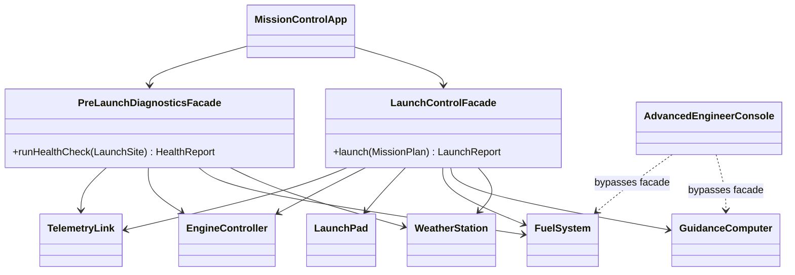

# Assignment 4 — Facade Pattern: Rocket Launch Control

**Course:** Software Design Patterns · **Pattern:** Facade (structural) · **Language:** Java 17+

## Topic

Launching a rocket takes six cooperating systems that must be driven in a strict order: compute the
trajectory, load exactly the right amount of propellant, pressurise the tanks, retract the service tower,
poll the weather, ignite, verify thrust, release the hold-down clamps and engage the autopilot. If any
step fails, everything done so far must be undone in reverse order (shut engines down, drain fuel, secure
the pad).

A mission-control client should not have to know any of that. It should say *"launch this mission"* and
get back either a report or a clear abort reason. `LaunchControlFacade` gives it that.

## Structure

```
src/main/java/kz/sdp/launch/
├── subsystem/                     <- complex subsystem (knows nothing about facades)
│   ├── WeatherStation.java        wind / lightning / temperature launch limits
│   ├── GuidanceComputer.java      delta-v to the target orbit, latitude vs inclination rule, autopilot
│   ├── FuelSystem.java            propellant mass via the rocket equation, tank capacity, pressure, drain
│   ├── LaunchPad.java             service tower and hold-down clamps
│   ├── EngineController.java      ignition, thrust check, shutdown, self-test
│   ├── TelemetryLink.java         numbered event log of one session
│   ├── FlightProfile.java, WeatherReport.java, SubsystemException.java
├── facade/                        <- main facade and its client-facing types
│   ├── LaunchControlFacade.java   launch(MissionPlan) -> LaunchReport | LaunchAbortedException
│   ├── MissionPlan.java, LaunchSite.java, LaunchReport.java, LaunchAbortedException.java
├── diagnostics/                   <- optional second facade
│   ├── PreLaunchDiagnosticsFacade.java   runHealthCheck(LaunchSite) -> HealthReport
│   └── HealthReport.java
└── app/
    ├── MissionControlApp.java     the client: uses ONLY the two facades
    └── AdvancedEngineerConsole.java  advanced client that bypasses the facade on purpose
```

## UML



Arrows only point *from* the facades *to* the subsystem. No subsystem class imports anything from
`facade` or `diagnostics`.

## How the subsystem classes interact

The output of one subsystem is the input of the next, which is why the order matters:

1. `GuidanceComputer.computeTrajectory(latitude, altitude, inclination)` → `FlightProfile` with the required delta-v
2. `FuelSystem.loadPropellantFor(deltaV)` → propellant mass from the Tsiolkovsky equation; fails if it exceeds tank capacity
3. `FuelSystem.pressurize()` → tank pressure
4. `LaunchPad.retractServiceTower()`
5. `WeatherStation.assertWithinLaunchLimits(site)` — final go/no-go poll
6. `EngineController.ignite(tankPressure)` → refuses to ignite below the minimum feed pressure; `verifyNominalThrust()`
7. `LaunchPad.releaseHoldDownClamps()` → refuses while the tower is still attached
8. `GuidanceComputer.engageAutopilot()` → refuses without a loaded trajectory

`TelemetryLink` records every step. On any `SubsystemException` the facade rolls back:
engines off → drain propellant → secure pad → reset guidance.

## Run

From IntelliJ: open the folder as a Maven project and run `MissionControlApp` (and optionally
`AdvancedEngineerConsole`).

From a terminal:

```bash
javac -d out $(find src -name "*.java")
java -cp out kz.sdp.launch.app.MissionControlApp
java -cp out kz.sdp.launch.app.AdvancedEngineerConsole
```

The demo runs four missions, each one exercising a different path:

| Mission | Site | Result | Why |
|---|---|---|---|
| ISS-Resupply (410 km, 51.6°) | Baikonur | lift-off | all systems nominal |
| Equatorial-Sat (550 km, 6°) | Kourou | **abort after fuelling** | lightning at the final weather poll → propellant drained, pad secured |
| Geo-Comsat (35 786 km) | Baikonur | **abort before fuelling** | needs ~422 t of propellant, tanks hold 300 t |
| Polar-Imager (700 km, 98°) | Baikonur | lift-off | all systems nominal |

## Facade properties satisfied

| Requirement | Where |
|---|---|
| 4+ subsystem classes with real responsibilities | six classes in `subsystem/`, each with its own rules and validation |
| One facade with a small API | `LaunchControlFacade` has exactly one public operation: `launch(MissionPlan)` |
| Coordinates in the correct order | private steps `planTrajectory → fuelVehicle → runFinalCountdown → liftOff` |
| Optional second facade | `PreLaunchDiagnosticsFacade`: read-only health checks, unrelated to launching |
| Client uses only the facade | `MissionControlApp` imports only `facade.*` and `diagnostics.*` |
| Subsystems unaware of the facade | no subsystem class references `facade` or `diagnostics` |
| Subsystems still usable directly | `AdvancedEngineerConsole` builds a delta-v / propellant table using `GuidanceComputer` and `FuelSystem` directly |

## Clean Code principles

1. **Meaningful names.** The public API reads like the domain: `launch(MissionPlan)`,
   `runHealthCheck(LaunchSite)`, `assertWithinLaunchLimits`, `releaseHoldDownClamps`,
   `abortAndSecureVehicle`. Units are part of the name (`targetAltitudeKm`, `tankPressureBar`,
   `deltaVKms`), so nobody has to guess whether a number is metres or kilometres. Magic numbers are named
   constants (`MAX_WIND_SPEED_MS`, `TANK_CAPACITY_KG`, `EARTH_MU_KM3_S2`).

2. **Single Responsibility — the facade coordinates, it does not compute.** `LaunchControlFacade`
   contains no physics and no safety limits. The rocket equation lives in `FuelSystem`, orbital mechanics
   in `GuidanceComputer`, weather limits in `WeatherStation`. The facade only calls them in order and
   passes one result to the next step.

3. **No leaking of subsystem details.** The client gives a `MissionPlan` and a `LaunchSite`, and gets back
   a `LaunchReport` or a `LaunchAbortedException`. All of these are in the `facade` package and hold only
   plain values. `FlightProfile`, `WeatherReport` and `SubsystemException` never appear in a public
   facade signature; the subsystem exception is translated into `LaunchAbortedException` (kept as the
   `cause` for debugging).

4. **Small, focused subsystem classes and functions.** Each subsystem class is under ~80 lines and does
   one thing. `launch()` is a short list of four intention-revealing steps; each step is its own private
   method of a few lines. Validation lives where the data is created (`MissionPlan`'s compact constructor).

5. **Proper error handling for coordination failures.** Subsystems fail fast with a descriptive
   `SubsystemException` instead of returning error codes. The facade catches it in one place, rolls back
   only what was actually done (checks `isRunning()`, `isFueled()`, `isVehicleReleased()`), closes the
   telemetry session and throws a checked `LaunchAbortedException`, so the client *must* handle an
   abort. The vehicle is never left fuelled on an open pad.

6. **Immutability and defensive copies.** `MissionPlan`, `LaunchReport`, `FlightProfile`,
   `WeatherReport` and `HealthReport` are records. Lists and maps are copied (`List.copyOf`,
   unmodifiable `LinkedHashMap`) so a client cannot change a report after it was produced.

7. **Dependency injection for flexibility.** Both facades have a no-argument constructor for ordinary
   clients and a constructor that accepts the subsystem instances, so they can be shared, replaced by test
   doubles or configured differently without changing the facade.
